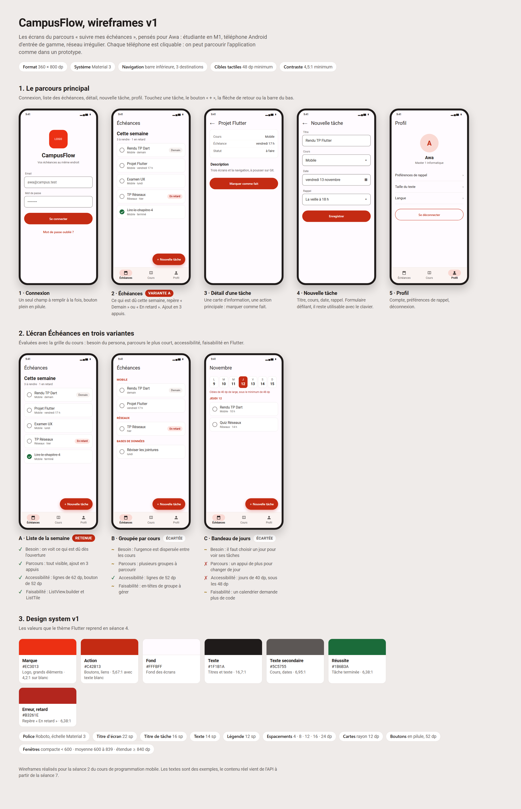

# Wireframes

Les cinq écrans, les trois variantes de l'écran Échéances, le choix justifié et le design system sont regroupés sur une seule page : [wireframes.html](wireframes.html).

C'est une page interactive : chaque téléphone se parcourt comme un prototype (toucher une tâche, le bouton « + », la flèche de retour, la barre du bas). Pour l'ouvrir, télécharger le fichier et le lancer dans un navigateur, ou utiliser [cet aperçu en ligne](https://htmlpreview.github.io/?https://github.com/Laureelo/campusflow/blob/main/docs/seance-2-conception/wireframes.html).

## Les cinq écrans

| # | Écran | Rôle |
|---|---|---|
| 1 | Connexion | Email, mot de passe, bouton plein |
| 2 | Échéances | Ce qui est dû cette semaine, ajout en trois appuis |
| 3 | Détail d'une tâche | Informations et action principale « Marquer comme fait » |
| 4 | Nouvelle tâche | Titre, cours, date, rappel |
| 5 | Profil | Compte, préférences de rappel, déconnexion |

La navigation principale est une barre inférieure avec trois destinations (Échéances, Cours, Profil), parce que ce sont trois destinations de même niveau, atteignables au pouce.

## Écran Échéances : trois variantes

**Variante A : liste de la semaine.** Une liste simple des tâches de la semaine, avec un repère « Demain » ou « En retard » à droite et un bouton pour ajouter.

**Variante B : groupée par cours.** Les tâches sont rangées sous le nom de leur cours.

**Variante C : bandeau de jours.** Une rangée de sept jours en haut, puis les tâches du jour choisi.

## Choix : la variante A

Évaluation avec les cinq questions de la grille du cours.

| Question | A | B | C |
|---|---|---|---|
| 1. Répond au besoin du persona ? | Oui : on voit ce qui est dû cette semaine (job story 1) | En partie : l'urgence est dispersée entre les cours | En partie : il faut choisir un jour pour voir ses tâches |
| 2. Parcours le plus court ? | Oui : tout est visible dès l'ouverture, ajout en 3 appuis (bouton +, champ titre, Enregistrer) | Idem pour l'ajout, mais il faut parcourir plusieurs groupes | Non : un appui de plus pour changer de jour |
| 3. Accessible ? | Oui : lignes de 62 dp, bouton de 52 dp | Oui : lignes de 52 dp | Non : les jours font 40 dp de large, sous le minimum de 48 dp |
| 4. Réalisable en Flutter ? | Oui : ListView.builder et ListTile | Oui : mais en-têtes de groupe à gérer | Oui : mais un calendrier demande plus de code |
| 5. Cohérent avec le design system ? | Oui : composant carte de tâche | Oui | Ajoute un composant (sélecteur de jour) |

La variante A est retenue. Elle répond directement à la job story 1, c'est la plus courte, et c'est celle qui respecte tous les seuils d'accessibilité sans modification. La variante B pourra servir plus tard comme filtre sur l'écran Cours.
